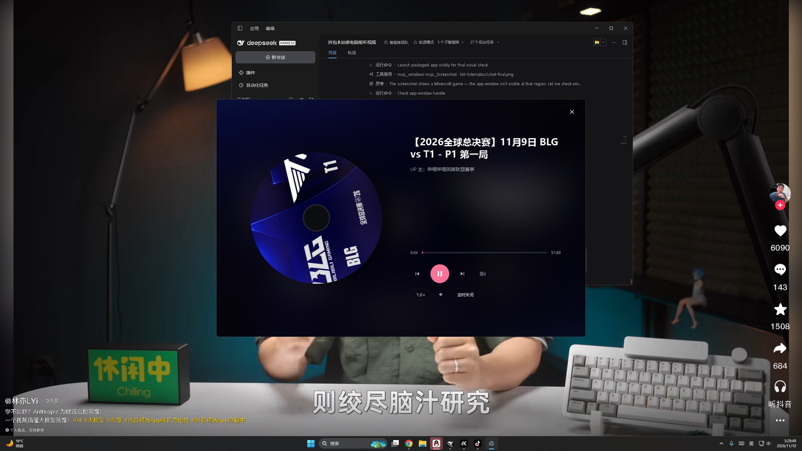

# BiliListen · 哔哩哔哩「听视频」桌面版

把 B 站手机客户端的「听视频」功能搬到 Windows 桌面上：**只拉音频流，不拉视频流**，省流量、省电、能后台挂着当音乐播放器用。

```
bili-listen/
├── apk\bilibili-latest.apk        # 拆包目标（B 站 Android v8.91.1）
├── decoded\apktool\               # apktool 解包产物（资源/Manifest）
├── decoded\smali\                 # baksmali 产物（38 个 dex → 521 个 podcast smali）
├── dexstrings.txt                 # 全部 38 个 DEX 的字符串导出（2,579,504 条）
├── docs\
│   ├── REVERSE-NOTES.md           # ★ 逆向笔记：听视频到底怎么实现的
│   ├── APK-SMALI-EVIDENCE.md      # ★ 证据附录：每条结论对应的 smali 原文
│   ├── FRONTEND-SPEC.md           # 前端开发规格（交给子代理的）
│   └── UI-REFERENCE.md            # 手机版控件树 → 桌面端映射
└── app\                           # 桌面应用
    ├── electron\
    │   ├── main.js                # 主进程：窗口/托盘/媒体键/IPC
    │   ├── preload.js             # contextBridge 暴露 window.bili
    │   └── services\
    │       ├── bili.js            # B 站 API 封装（wbi 签名 / playurl / 字幕）
    │       ├── proxy.js           # 本地音频代理（补 Referer + Range 透传）
    │       └── tv-login.js        # TV 端扫码登录
    ├── src\                       # 前端（glm-5.3-flash 子代理实现）
    │   ├── index.html
    │   ├── styles\                # base / layout / components / supplement
    │   └── js\
    │       ├── app.js             # 入口
    │       ├── api.js             # window.bili 封装
    │       ├── store.js           # 全局状态 + localStorage
    │       ├── player.js          # 音频播放内核
    │       ├── playlist.js        # 自动生成播放目录（热门/榜单/收藏/相关推荐）
    │       ├── router.js          # hash 路由
    │       ├── utils.js           # el() / 格式化 / 二分查找
    │       ├── debug-bridge.js    # CDP 自动化句柄（window.__bili）
    │       ├── views\             # discover/ranking/search/favorites/history/nowplaying
    │       └── components\        # titlebar/sidebar/playbar/queue/card/toast/modal
    ├── scripts\
    │   ├── launch.js              # 启动器（清 ELECTRON_RUN_AS_NODE）
    │   ├── build.js               # 打包脚本（检测 certs\codesign.pfx 自动签名）
    │   ├── make-cert.js           # 自签名代码签名证书生成（一次性）
    │   ├── verify.js              # CDP 自动化验收（10 项）
    │   ├── verify-settings.js     # 设置页验收（11 项）
    │   ├── verify-packaged.js     # 打包版验收（9 项，连已启动的 exe）
    │   └── verify-login.js        # 登录专项验收（8 项）
    ├── start.bat                  # 双击启动
    └── package.json
```

## 快速开始

```powershell
cd app
npm start          # 或双击 start.bat
```

> **坑**：本机全局环境变量 `ELECTRON_RUN_AS_NODE=1`，直接跑 `electron.exe` 会让它退化成纯 Node 进程（`app` 是 undefined）。`start.bat` 和 `scripts/launch.js` 都会先清掉它。

## 装成桌面应用（Windows 安装包）

```powershell
cd app
node scripts\build.js
# 产物：
#   dist\BiliListen-Setup-1.1.0.exe     安装包（65.6 MB）
#   dist\BiliListen-win32-x64\          免安装目录版（整个文件夹拷走也能跑）
```

双击 `BiliListen-Setup-1.1.0.exe`，跟市面上的桌面软件一样：

1. 选安装位置（默认 `%LOCALAPPDATA%\Programs\BiliListen`，**当前用户安装，不要管理员权限**，不弹 UAC）
2. 装完自动在**桌面**和**开始菜单**创建 `BiliListen` 快捷方式，并直接启动
3. 控制面板「应用和功能」里能正常卸载（卸载**不会删**你的数据）

## 代码签名（自签名，凭证可复用）

```powershell
cd app
node scripts\make-cert.js        # 一次性：生成自签名代码签名证书（10 年有效）
node scripts\build.js            # 检测到 certs\codesign.pfx 就自动签名
```

- 证书和密码落在 `certs\`（已在 `.gitignore`，绝不进仓库）。生成一次长期复用；以后换商业证书只替换 PFX 文件，构建脚本不用动。
- **签名由 electron-builder 在构建过程中完成**（构建脚本通过 `WIN_CSC_LINK`/`WIN_CSC_KEY_PASSWORD` 环境变量把 PFX 交给它，密码不落盘到 package.json）：应用 exe → `elevate.exe` → NSIS 卸载器 → 最终安装器，全部按正确顺序签名，并在签名后生成 blockmap。构建结束后脚本会用 PowerShell `Get-AuthenticodeSignature` 校验签名者指纹，验不过直接构建失败。
- 签名带 **DigiCert RFC3161 时间戳**：证书将来过期，已签好的安装包依然验证有效。
- 边界要说清楚：自签名给安装包挂上真实的签名者信息（不再「unsigned」），导入过证书的机器完全信任；但**陌生机器上的 SmartScreen「未知发布者」提示消除不了**——那靠 CA 信誉链，公开分发想全绿只能买商业证书（OV 约 1000–3000 元/年）。

未签名的安装包首次运行，SmartScreen 点「更多信息 → 仍要运行」即可。

## 数据存在哪（关掉再开接着听）

| 存了什么 | 位置 |
|---|---|
| 登录态（SESSDATA）、音量、倍速、音质、播放模式、主题、窗口大小、上次停留页面 | `%APPDATA%\BiliListen\bili-listen-config.json` |
| **播放队列 + 当前曲目 + 听到第几秒** | 同上，`session` 字段 |
| 本地播放记录、搜索历史 | 同目录下的 Chromium `Local Storage` |
| 登录窗口的 Cookie 分区 | 同目录下的 `Network\Cookies` |

设置页里「数据目录 → 打开目录」能直接跳过去，卸载重装、换机器拷走这个文件夹就能恢复。

写盘策略是 **先写 `.tmp` 再原子 rename，并留一份 `.bak`**：强杀进程、断电都不会留下半截 JSON；主文件要是真坏了，启动时会自动从 `.bak` 回滚。退出（含托盘退出）走同步 flush，防抖队列里的改动不会丢。

从旧版本（`%APPDATA%\bili-listen-desktop`）升级的，首次启动会自动迁移配置、登录态和播放记录，不用重新登录。

## 自动化验收

```powershell
cd app
node scripts\verify.js             # 基础 10 项
node scripts\verify-settings.js    # 设置与倍速
node scripts\verify-persistence.js # 关掉再开 18 项
node scripts\verify-login.js       # 登录 8 项
node scripts\verify-cookie-import.js
```

用 CDP 连进渲染进程，10 项全过（实测 10/10）：

```
PASS  1. 窗口启动无白屏
PASS  2. 发现页真实卡片（20 张）
PASS  3. 点卡片能播放（静音，本地代理出流）
PASS  4. 倍速可控
PASS  5. 主题切换
PASS  6. 控制台无 error
PASS  7. 排行榜渲染（30 行 5 Tab）
PASS  8. 搜索出结果
PASS  9. 全屏播放页展开（黑胶 spin 动画）
PASS 10. 队列抽屉打开
```

### 三套补充验收脚本

| 脚本 | 覆盖 | 实测 |
|---|---|---|
| `node scripts\verify-settings.js` | 发现页骨架卡清理 / 设置页 / 音质·倍速·托盘三项落盘 | **11/11** |
| `node scripts\verify-packaged.js` | **打包版**（自动启动 `dist\BiliListen.exe`，验完自动关）：卡片/播放/6 档倍速/队列/全屏/倍速菜单/设置页 | **9/9** |
| `node scripts\verify-persistence.js` | **关掉再开还在不在**：队列/当前曲目/断点秒数/上次页面，强杀后 JSON 不坏、不自动出声、点播放续播 | **18/18** |
| `node scripts\verify-login.js` | 扫码二维码生成 / 轮询 / 浏览器登录 IPC / Cookie 校验 / 三 Tab 弹层 | **8/8** |
| `node scripts\verify-cookie-import.js` | 粘贴 Cookie 的解析（裸值/整行/脏输入/头注入）+ 落盘补全 + 假凭据必须被拒 | **15/15**（设 `BILI_TEST_COOKIE` 时 16/16） |
| `node scripts\verify-features.js` | **v1.1.0 新功能专项**：倍速下拉 6 档 / 定时关闭双开关（播完当前 + N 分钟可同时启用）/ 侧边栏自动目录（热门/榜单/收藏一键灌队列）/ 卡片菜单「以此生成播放目录」 | **10/10** |

> **测试全程静音 + 不弹窗**：`verify.js` 启动参数带 `--mute-audio --hidden`，主进程 `isHidden` 分支不调用 `win.show()`，任务栏都看不到窗口。
>
> 本机另有两个坑：全局环境变量 `ELECTRON_RUN_AS_NODE=1`（不清会让 electron 退化成纯 Node）、GPU 进程崩溃 `exit_code=-1073740791`（加 `--disable-gpu`）。

## 打包

```powershell
cd app
node scripts\build.js            # 安装包 + 目录版（约 90 秒）
node scripts\build.js --dir      # 只出目录版，快，验收用
node scripts\make-icon.js        # 改图标后重出 build\icon.ico（SVG → 10 档尺寸）
node scripts\make-cert.js        # 一次性：生成自签名代码签名证书（见「代码签名」一节）
```

构建用 electron-builder：应用代码打成 `app.asar`（1.7 MB），Electron 运行时保留 `zh-CN`/`en-US` 两套语言包。

产物已实测（`verify-packaged.js` 9/9）：20 张卡片、点播出声、图片代理、6 档倍速、全屏播放页、设置页完整。

### 冷启动实测

从双击图标到窗口出现（同一台机器，装好后连测 3 次）：

| 次数 | 耗时 |
|---|---|
| 1（首次，磁盘冷） | 435 ms |
| 2 | 291 ms |
| 3 | 282 ms |
| 平均 | **约 336 ms** |

为这个数字做的三件事（v1.1.0 静默安装实测，3 次平均 336 ms）：

1. **窗口先出、代理后起** —— 原先 `await proxy.start()` 挡在 `createWindow()` 前面，白白多等一轮端口监听；现在先画窗口，音频代理在后台起。
2. **qrcode 懒加载** —— 二维码库（带 pngjs）只在真点「扫码登录」时才 require，启动阶段不解析。
3. **asar 打包** —— 几百个小文件合成一个包，少掉大量目录遍历和 CreateFile。

---

## 一、逆向：手机版「听视频」是怎么做的

完整笔记见 [REVERSE-NOTES.md](docs/REVERSE-NOTES.md)，这里只摘结论。

### 1.1 它不是独立功能，是 `music_podcast` 模块

包名 `com.bilibili.music.podcast`，**521 个 smali 文件**（`view/` 121 + `fragment/` 116 + `utils/` 96 + `collection/` 56 + `data/` 51 + `legacy/` 43 + `moss/` 18 + `player/` 8 + 根级 12），含 8 个 Activity，加上 `tv.danmaku.bili.ui.player.notification.BackgroundMusicService`（前台服务，`foregroundServiceType=mediaPlayback`）。

深链入口：`bilibili://music` / `bilibili://podcast`（Manifest 里两条 `<data>`），说明它是可独立跳转的业务模块。

### 1.2 播放链路

```
MusicPodcastResolver.requestPlayView(params)
  → ListenerMoss.executePlayURL(PlayURLReq)
  → gRPC: bilibili.app.listener.v1.Listener/PlayURL
  → PlayURLResp{ playable, player_info: map<cid, PlayInfo> }
  → PlayInfo.play_dash.audio[]  ← 只播这个，不碰 video[]
```

**关键发现：`app.listener.v1.PlayDASH` 这个 proto 里根本没有视频轨字段。**
同一 APK 里的标准播放接口 `app.playurl.v1.ResponseDash` 有 `VIDEO=1 / AUDIO=2` 两条轨，它的 `DashItem` 还带 `FRAME_RATE=8` 和 `WIDEVINE_PSSH=9 / BILIDRM_URI=10`（DRM）；而听视频专用的 `PlayDASH` 只有 `AUDIO=3 / DURATION=1 / MIN_BUFFER_TIME=2` 三个字段，`DashItem` 也没有帧率和 DRM 字段。

也就是说「省流量」不是靠"拉了视频不看"，而是**服务端在 protobuf schema 层面就把视频轨削掉了**，客户端连想拉都拉不到。这是本次逆向最有价值的一条结论，证据在 [APK-SMALI-EVIDENCE.md](docs/APK-SMALI-EVIDENCE.md) 第 2.3.1 节。

反编译原文（`com.bilibili.music.podcast.player.resolve.MusicPodcastResolver`）：

```java
private final PlayURLResp requestPlayView(MusicPodcastResolverParams params) throws MossException {
    long oid = params.getOid();
    return new ListenerMoss(null, 0, null, 7, null).executePlayURL(
        PlayURLReq.newBuilder()
            .setItem(PlayItem.newBuilder()
                .setItemType(params.getType())   // 1=OGV 2=UGC 3=音频稿件
                .setOid(oid)                     // aid / season_id / song_id
                .addSubId(params.a())            // cid
                .build())
            .setPlayerArgs(MusicMossApiService.a().u())
            .build());
}
```

`PlayerArgs` 的构造（`MusicMossApiService.u()`）：

```java
PlayerArgs.newBuilder()
  .setQn(0x40)                                  // 64 = 请求 DASH 音质表
  .setFnver(PlayUrlFlagsManager.getFnVer())
  .setFnval(PlayUrlFlagsManager.getFnVal())
  .setSoftFnval(PlayUrlFlagsManager.getSoftFnVal())
  .setForceHost(PlayerSettingHelper.getForceHost())
  .setVoiceBalance(IjkOptionsHelper.getVolumeBalance() ? 1 : 0)
  .build();
```

### 1.3 桌面端等价实现

Web 端同一套 playurl 网关有 REST 版本，语义完全一致：

```
GET https://api.bilibili.com/x/player/wbi/playurl
    ?bvid=BVxxx&cid=123&fnval=4048&fnver=0&fourk=1&platform=pc   (+ wbi 签名)
→ data.dash.audio[] { id, baseUrl, backupUrl[], bandwidth, codecs, mimeType }
```

`fnval=4048` = DASH(16) | HDR(64) | 4K(128) | 杜比音频(256) | 杜比视觉(512) | 8K(1024) | AV1(2048)。

### 1.4 为什么必须有本地代理

音频 CDN（`*.bilivideo.cn:8082`）校验 `Referer: https://www.bilibili.com/` 和 UA，`<audio src="...">` 没法自定义请求头，直连必 403。

`services/proxy.js` 起一个 `127.0.0.1:45871` 的 HTTP 服务（端口固定，因为前端要提前拼图片代理 URL）：

- 前端拿 `localUrl`（`http://127.0.0.1:45871/audio/<bvid>_<cid>`）当 src
- 代理收到请求后补上 Referer/UA 转发到 CDN
- **透传 Range 头**，所以拖动进度条是 206 局部拉取，不是重下整个文件
- 地址 90 分钟过期，代理层检查 `expireAt`，快过期时自动重新调 playurl 换新地址，前端无感
- `backupUrl[]` 里还有 2 个备用 CDN，主地址失败自动换
- 同一个服务还兼职**图片代理**（`/img?u=<encoded>`），因为 `` 同样无法带 Referer，`i0.hdslb.com` 会 403

### 1.5 wbi 签名

B 站 2023 年起 Web API 要 `w_rid` 签名：

1. `GET /x/web-interface/nav` 拿 `wbi_img.img_url` 和 `sub_url`
2. 各取文件名（去掉路径和 `.png`），得到 `img_key` / `sub_key`
3. 64 位置换表 `MIXIN_KEY_ENC_TAB` 按 `img_key+sub_key` 取值，取前 32 位当 `mixin_key`
4. 参数按 key 字典序排序、值剔除 `!'()*`、URL 编码，拼成 query，末尾加 `wts=时间戳`
5. `w_rid = md5(query + mixin_key)`

实现在 `services/bili.js` 的 `signedQuery()`，key 缓存 30 分钟。

---

## 二、登录（三套方案，全都不依赖手机）

| 方式 | 原理 | 状态 |
|---|---|---|
| **粘贴 Cookie（最省事）** | 从浏览器 DevTools 的 `Application → Cookies` 复制 `SESSDATA` 的 Value（它是 **HttpOnly**，控制台里 `document.cookie` 永远读不到），应用内解析 + `/x/web-interface/nav` 校验后落盘 | ✅ 15/15 验收通过 |
| **窗口登录（免扫码）** | 独立浏览器分区（`persist:bili-login`）打开 passport 登录页，可用其中的「密码登录」；主进程直读该分区 Cookie | ✅ 开窗 / 读 Cookie 链路已验证 |
| 扫码登录 | B 站 TV 端接口，二维码画在应用内，手机 App 扫码确认 | ✅ 8/8 验收通过 |

### 没有手机怎么登录

两条路都不需要手机，也不需要扫码：

1. **窗口登录 → 密码登录**：登录弹层切到「窗口登录」，在弹出的窗口里选「密码登录」页签，账号可以是邮箱 / 用户名 / 手机号，出现滑块就用鼠标拖。
2. **粘贴 Cookie**：如果电脑浏览器里已经登录着 B 站，直接把这台机器的登录态搬过来。
   - 浏览器打开 `bilibili.com` → `F12` → `Application（应用）` → `Storage → Cookies → https://www.bilibili.com`
   - 找到 `SESSDATA` 那一行，双击 `Value` 全选复制
   - 回到应用的「粘贴 Cookie」页签 → 「从剪贴板粘贴」→ 「登录」
   - 也可以从 `Network → 任意请求 → Request Headers → Cookie` 复制整行，两种格式都认

> 为什么不能像以前那样「在浏览器里敲 `document.cookie` 再贴进来」：`SESSDATA` 是 `HttpOnly`，`document.cookie` 里根本没有它。应用会认出来并直接告诉你这一点，而不是给你一句「登录失败」。
>
> 应用内粘贴面板会做三件事：解析（裸值 / 整行 / 带 `Cookie:` 前缀 / 多行都认）、校验（`nav` 接口确认真的登录了才落盘）、补全（用 `mid` 自动补 `DedeUserID`，收藏夹和历史接口要用）。

### 扫码登录是怎么做的

逆向 APK 的 TV 登录模块（`com.bilibili.tv` 相关），拿到两个公开常量：

```
APPKEY = 4409e2ce8ffd12b8
APPSEC = 59b43e04ad6965f34319062b478f83dd
```

签名：参数按 key 字典序 → `k=urlencode(v)` 拼 `&` → 末尾直接接 APPSEC → MD5。

```
POST https://passport.bilibili.com/x/passport-tv-login/qrcode/auth_code
  appkey=...&local_id=0&ts=<秒>&sign=<md5>
  → { code:0, data:{ url, auth_code } }

POST https://passport.bilibili.com/x/passport-tv-login/qrcode/poll
  appkey=...&local_id=0&auth_code=...&ts=<秒>&sign=<md5>
  → code 0     = 成功，data.cookie_info.cookies[] 直接给 Cookie
  → code 86039 = 未扫码
  → code 86090 = 已扫码待确认
  → code 86038 = 二维码失效
```

这套是电视端「云视听小电视」的登录通道，等同在 TV 上登录，Cookie 由官方下发，全程不碰密码。

**为什么不再用「回传书签 / 系统浏览器」**：`SESSDATA` 是 **HttpOnly**，浏览器里 `document.cookie` 根本读不到；而 passport 的跨域登录同步只对自家域生效，`gourl` 指到 `127.0.0.1` 也不会把凭据带过来。也就是说「在系统浏览器登录 → 把 Cookie 送回本机」这条路在 Web 安全模型下走不通。

现在改成：登录跑在一个**独立分区（`persist:bili-login`）的应用内窗口**里，登录页本身照常渲染（扫码 / 密码 / 短信 / 微信全都在，实测 passport 页面完整加载），主进程用 `session.fromPartition(...).cookies.get()` 直接读该分区的 Cookie——这是唯一能拿到 HttpOnly `SESSDATA` 的途径。登录态常驻该分区，下次开窗直接复用。

**验收结果（`node scripts/verify-login.js`，静默无窗口）：**

```
PASS  1. 扫码登录：二维码生成          host=passport.bilibili.com imgLen=3986 exp=180
PASS  2. 二维码指向官方 TV 登录域      /x/passport-tv-login/h5/qrcode/auth
PASS  3. 扫码：轮询状态正常            waiting
PASS  4. 浏览器登录：IPC 已注册          function
PASS  5. Cookie 登录：空值安全拒绝
PASS  6. 登录态查询可用
PASS  7. 登录弹层三 Tab               扫码登录 / 窗口登录 / 粘贴 Cookie
PASS  8. 弹层内二维码实际渲染           naturalWidth=280
```

**粘贴 Cookie 专项验收（`node scripts/verify-cookie-import.js`）：**

```
[1] 解析：粘贴形态                 5/5   裸 SESSDATA / 整行 / 带前缀 / 多行 / 脏串
[2] 解析：错误输入                 5/5   空值 / 无 SESSDATA / 自由文本 / 控制字符 / 头注入
[3] 落盘前补全 Cookie              3/3   自动补 DedeUserID、不重复、无 mid 不造脏字段
[4] 真实接口登录态判定             2/2   假 SESSDATA 必须判未登录
```

> 第 [2] 组里那条「无 SESSDATA」用例就是专门守 `document.cookie` 这个坑的：把 `buvid3=...; b_nut=...` 这种串贴进去，应用必须认出来并提示「SESSDATA 是 HttpOnly，去 Application 面板复制」。

---

## 三、从手机版抄过来的功能

| 手机版 | 桌面版实现 |
|---|---|
| `BackgroundMusicService` 前台服务 | Electron 主进程常驻 + 托盘 |
| 通知栏 12 个 action | 托盘右键菜单 + 全局媒体键 |
| `music_podcast_bottom_play_view` | 底部 88px 播放条 |
| `music_podcast_include_play_panel` | 全屏「正在播放」页 |
| `PodcastSpeedSeekBar` 6 档 | 倍速**下拉列表选择** **0.5 / 0.75 / 1.0 / 1.25 / 1.5 / 2.0**（与 APK 数组逐值一致，默认 1.0×） |
| `music_podcast_dialog_player_setting` | 播放设置弹层 |
| 「定时关闭」超级菜单 | 定时关闭弹层：**播完当前曲目暂停** + **15/30/45/60/90/120 分钟定时暂停**，两个开关可同时启用（先到者触发，触发后另一个自动清掉） |
| 播放列表 / 收藏夹 / 最近在听 | 队列抽屉 / 收藏页 / 历史页 |
| 自动连播相关视频 | 播放到 90% 预取下一首 |
| **自动生成播放列表** | **侧边栏「自动目录」**：一键把热门 / 音乐榜 / 收藏夹灌进队列开听；任意视频卡片「⋯ → 以此生成播放目录」按相关推荐连续成串 |
| 分P 展开 | 多分P视频自动拆成队列项 |
| 字幕当歌词 | `player/v2` 字幕轨 → 歌词滚动 |

砍掉的：弹幕、投币、点赞（听视频场景用不上，保留「在浏览器打开」外链）。

### 实机截图

全屏「正在播放」页（黑胶唱片旋转 + 封面高斯模糊背景 + 进度条 + 倍速/音量/定时）：



---

## 四、已知限制

1. **付费/大会员内容**：`playurl` 只返 64K/132K 试听片段，需要登录且开通大会员。桌面端会如实弹「没有可用的音频流」。
2. **地区限制**：港澳台/海外番剧需要对应地区 IP。
3. **登录方式**：三套（TV 扫码 / 内嵌网页 / 粘贴 Cookie）。扫码是主方案，走 B 站 TV 端官方接口。Cookie 明文存 `%APPDATA%\bili-listen-desktop\bili-listen-config.json`。
4. **字幕覆盖率**：只有 UP 主上传或 B 站 AI 生成的字幕才有歌词，大部分音乐区视频没有。
5. **音频编码**：默认 AAC（mp4a.40.2），Chromium 原生支持。杜比（EC3）和 Hi-Res（FLAC）需要大会员且部分设备解码不了，选了会静默回落到 192K。

---

## 五、拆包环境

```powershell
# 本机已有
A:\Tools\rea-tools\apktool_2.11.1.jar     # apktool
A:\Tools\rea-tools\jadx-headless-mcp-0.7.1-all.jar   # jadx（MCP 模式）
C:\Program Files\Java\jdk-21.0.12          # JDK 21
A:\Android\Sdk\build-tools\36.1.0\aapt2.exe
```

重新解包（两条路都实测过）：

```powershell
# A) 只解资源 + Manifest（快，约 40 秒）
java -jar A:\Tools\rea-tools\apktool_2.11.1.jar d -f -s -o decoded\apktool apk\bilibili-latest.apk

# B) 连 smali 一起反编译（慢，约 6 分钟，38 个 dex 全部 baksmali）
java -jar "C:\Users\27178\WorkBuddy AI\2026-10-03-07-32-11\.tools\apktool.jar" d -r -f -o decoded\smali apk\bilibili-latest.apk
#   注意 -r 是"跳过资源反编译"，不是"只解资源"；-s 才是"跳过 smali"
```

产物对照：

| 目录 | 内容 | 大小 |
|---|---|---|
| `decoded\apktool\` | `AndroidManifest.xml`、`res\`（含 201 个 `music_podcast_*` 资源）、`apktool.yml` | 425 MB |
| `decoded\smali\smali_classes2 ~ 38\` | 38 个 dex 的 smali（336,772 个文件；`music_podcast` 的 521 个在 `smali_classes16`） | 2.88 GB |

> 如果只想快速看某个类的逻辑，用 jadx 反编译成 Java 比读 smali 快得多：
> `A:\Tools\rea-tools\jadx-headless-mcp-0.7.1-all.jar`（MCP 模式）或 `jadx.bat`（CLI）。


